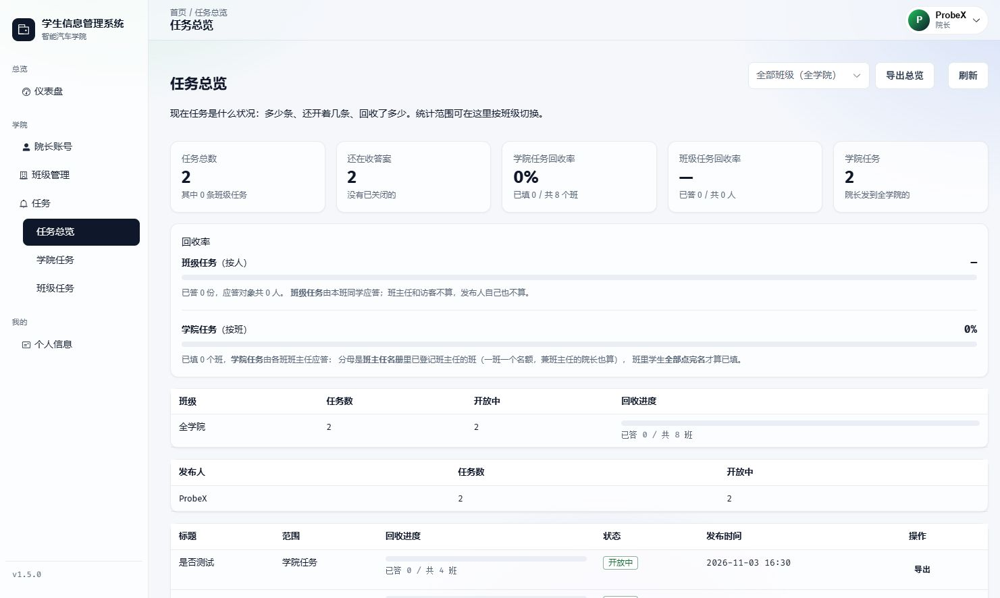
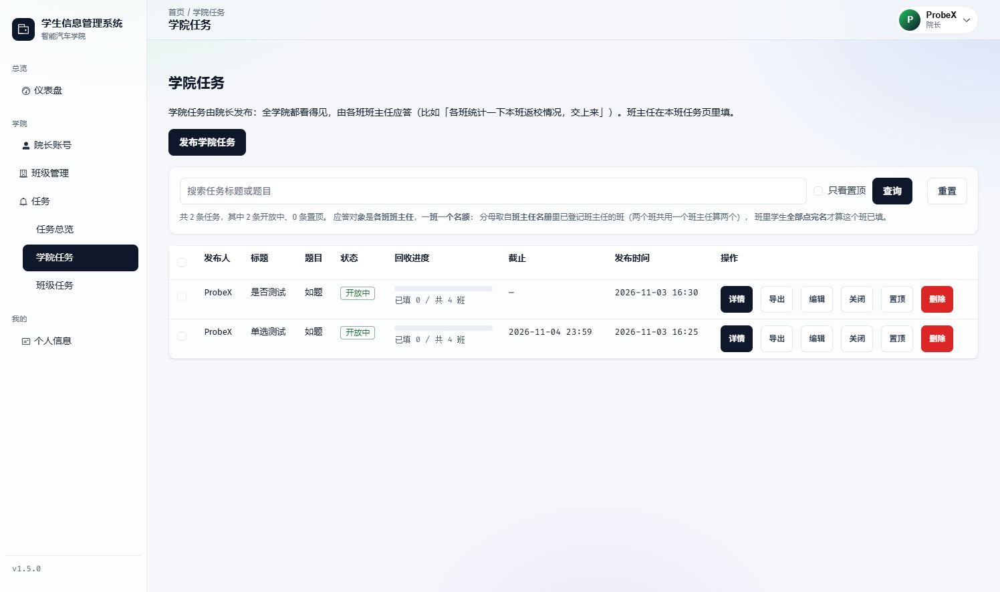

<div align="center">

# 学生信息管理系统

**面向学院的班费账本 + 学籍名册 + 学院任务协同：公开、透明、可追溯。**

[](LICENSE)
[](server-py/)
[](web/)
[](server-py/)

</div>

---

## 目录结构

```
classfee-manager/
├─ server-py/              后端（FastAPI，:8080）
│  ├─ app/                 routers（HTTP 层）· services（业务/事务）· models / security / seed
│  ├─ db/schema.sql        15 张表（启动时幂等执行）
│  └─ tests/api_regression.py   契约回归（零依赖，1263 项）
├─ web/                    前端（Vue 3 + Vite + Element Plus，:5173）
│  └─ src/                 api · views · components · stores · router
├─ assets/screenshots/     README 截图（演示数据）
├─ docs/                   部署指南 · 账号与权限 · 设计要点（GitHub 上仅这三份）
├─ log/                    运行日志（backend / frontend / database，不入库）
├─ docker-compose.yml                 一键部署（自带 MariaDB）
├─ docker-compose.use-existing-db.yml 复用服务器已有数据库
└─ .env.example            部署变量模板
```

**规模**：15 张表｜110 个 REST 端点｜前端 17 个页面｜Vue 3 + Element Plus · FastAPI + SQLAlchemy 2.0

---

## 这是什么

一个面向**单个学院**的系统，同时管三件事：

| 模块 | 一句话 |
|------|--------|
| **班费账本** | 按班记收支，批次逐人收班费、生成流水，记错作废红冲，全账可回溯（小票可挂、可查看） |
| **学籍名册** | 班主任逐人维护学生字段，学院侧按「申请 → 授权」看非管辖班数据 |
| **学院任务协同** | 院长发全学院任务，各班班主任逐人接龙回收；班主任可给自己班发班级任务 |

**没有注册页，只有登录页**：账号由部署方声明或运营在页面创建，代码里不写死任何默认口令。

---

## 功能一览

### 班主任 / 班长 / 生活委员（运营）

- **记账**：收入/支出登记（支出可挂小票）、账本明细多条件筛选并**导出 Excel**、记错作废红冲
- **收班费**：建批次 → 逐人标记缴费（**代缴可挂小票**）→ 自动生成流水、余额同步，批次回收进度一眼看清
- **班级公告**：发布 / 置顶 / 下架（可恢复）/ 彻底删除
- **学籍名册**：字段设计、逐人填值、批量导入 / 导出，跨班数据按「申请 → 授权」访问
- **班级任务**：发任务（是/否、单选、多选、日期）、答题统计、置顶到全班仪表盘
- **成员管理**：建号（四档角色）、改学号、重置密码、停用/启用、删除（仅限零引用）
- **班级信息**：名称 / 年级 / 班主任（余额只读）

### 学生（普通成员）

- **仪表盘**：余额与本月收支、缴费完成率、最新流水、置顶公告与置顶任务
- **我的缴费**：我交没交、什么时候截止
- **账本明细**：只读查看全班收支与公告（含小票）
- **班级任务**：答题、改答案
- **个人信息**：改登录名 / 密码 / 手机号 / 学号

### 院长（学院层全权）

- **学院任务**：发全学院任务（是/否、单选），各班班主任逐人接龙回收；任务明细按题型分流（是/否/日期→返校四桶；单选/多选→按选项），可置顶
- **学院名册**：各班班主任名册（一人一行）：建号 / 导入 / 改安排 / 批量删除，一眼看出哪个班没人管
- **任务总览**：全学院任务统计（总数/开放中/按班回收率/按发布人分布/最近任务），按班筛选、可导出
- **院长账号**：新增纯院长 / 兼班主任院长，指派管辖班
- **班级管理**：学院视角建班 / 停用 / 批量删除 / 改安排班主任

完整功能模块总表与「谁能用」对照 → [`docs/账号权限.md`](docs/账号权限.md)。





> 截图为本地演示实例（合成数据），能看到：学院任务由院长发布、按「已填班数」回收；任务总览一眼看清开放中任务与回收率。

---

## 快速开始

需要 Python 3.13+、Node 22+、一个 MySQL 8 / MariaDB 库。前后端启动时**自动建表、自动补种子数据**：

```bash
mysql -uroot -p -e "CREATE DATABASE classfee DEFAULT CHARSET utf8mb4;"

cd server-py && python -m venv .venv && .venv/bin/pip install -r requirements.txt \
  && .venv/bin/python -m uvicorn app.main:app --port 8080
cd web && npm install && npm run dev
```

登录账号由部署时声明（`CLASSFEE_TEACHER_USERNAME` / `PASSWORD`），或运营登录后在「成员管理」「学院 → 院长账号」里创建。

详细部署（手动 / Docker Compose / 排障 / 日志）见 **[`docs/部署-Linux.md`](docs/部署-Linux.md)**。

---

## 文档

| 文档 | 内容 |
|------|------|
| [`docs/部署-Linux.md`](docs/部署-Linux.md) | Linux 部署（systemd + nginx / Docker Compose）、验证清单、排障、运行日志配置 |
| [`docs/账号权限.md`](docs/账号权限.md) | 功能模块总表 · 角色六档与 `ROLE_LEVEL` · 账号来源与特性 · 跨班数据授权 |
| [`docs/设计要点.md`](docs/设计要点.md) | 记账/余额/金额/小票口径 · 任务回收率算法 · 15 张表 DDL |
| [`log/README.md`](log/README.md) | 运行日志：backend / frontend / database 三类分离、隐私底线 |

---

## License

[MIT](LICENSE) © 2026 Student Info Manager contributors
